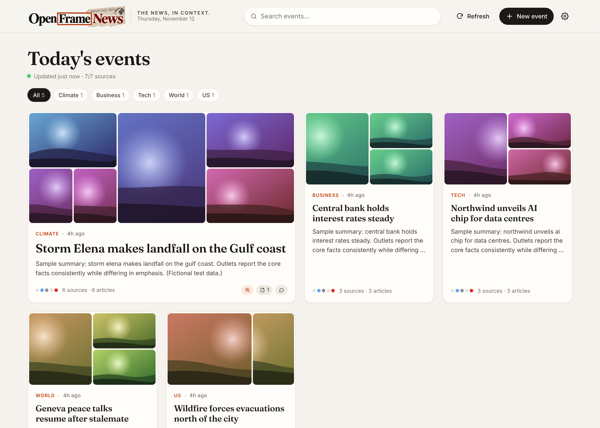
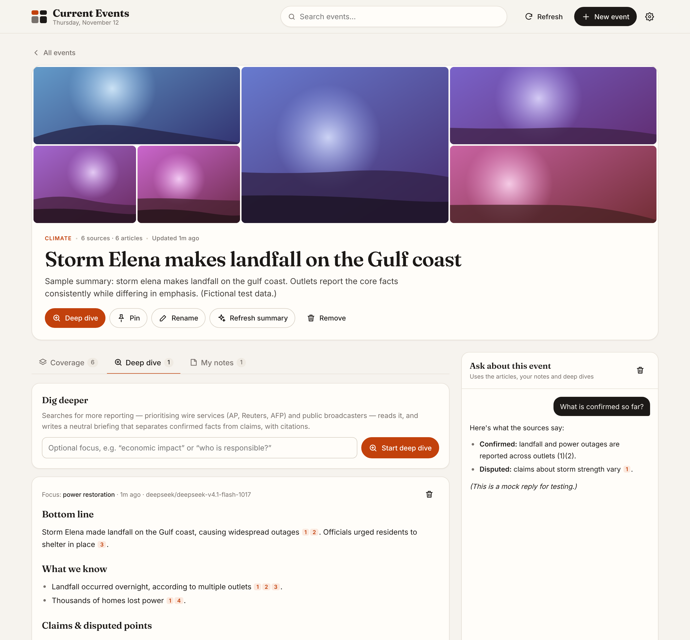

<p align="center"></p>

# OpenFrame News

**The news, in context.** A personal news dashboard that pulls articles from a balanced set of outlets, groups them into **events**, and lets you dig into each one with AI: a neutral deep-dive briefing built from wire services and public broadcasters, your own notes and custom data, and a chat grounded in the coverage.




_Screenshots use fictional sample data and placeholder images from the offline test server._

## Features

- **Automatic events.** Every 30 minutes (and on demand) it fetches ~19 RSS feeds and the AI groups articles about the same story into one event, with a neutral title, summary and category. New articles join existing events as stories develop.
- **Patchwork titles.** Each event's title sits under a quilt of the different outlets' headline images.
- **Make your own events.** "New event" takes a topic (e.g. "War in Iran") and/or a few article links. It searches Bing News, Google News and GDELT plus the articles already gathered, has the AI keep only the ones really about the topic, and writes a summary. With **Keep tracking** on, new matching articles are added on every refresh; **Find more coverage** searches again on demand. Links from sites that block automated readers are still added (as link-only).
- **Coverage by lean.** Each event shows how its coverage splits across left / center / right outlets.
- **Deep dive.** Searches for more reporting (GDELT news search, Google News, Wikipedia), prioritising AP, Reuters, AFP, BBC, NPR, PBS, DW and similar, reads the articles and writes a cited briefing: bottom line, what's confirmed, disputed claims, background, how coverage differs, open questions. You can give it a focus, or dig into one specific article.
- **Automatic reality check.** After every refresh, each story with two or more articles is challenged automatically: a plain-words summary, a verdict (Confirmed / Developing / Disputed / Unverified / Misleading), what's solid versus only claimed, how each side is spinning it, and what the coverage leaves out. The verdict shows on the home cards. Set `AUTO_CHECK=off` to disable or `AUTO_CHECK_MAX` (default 12) to limit checks per refresh.
- **Evidence, not just news.** Each deep dive pulls out the key factual claims and checks them against primary sources: research papers (OpenAlex, Crossref, Europe PMC), government records (US Federal Register, GOV.UK), government and international-body sites (.gov, WHO, UN, EU, World Bank, OECD, IMF) and fact-checkers (PolitiFact, FactCheck.org, Snopes, Full Fact). The briefing gets an **Evidence check** (Supported / Partly supported / Contradicted / Unverified per claim) and sources are labelled Study, Government, Official body or Fact-check. Untick the box to skip it.
- **Chat that can search the web.** When a question goes beyond the event's articles, the chat searches news, Wikipedia, research papers and fact-checkers, reads the top results and cites them as W1, W2… with links.
- **Assistant.** A general chat (the Assistant button in the header) for anything, news or not. It searches the web when needed and reads links and files you paste, attach or drop in (PDF, Word .docx, text, Markdown, CSV, JSON; up to 25 MB). Files added to an event are saved as notes. Ask it to find out about a story and it offers to create an event for it, add your links to an event, or run a deep dive. It always shows a confirmation card first and does nothing until you confirm.
- **Accounts.** People log in with email and password. The first account is the admin; everyone else needs the admin's invite code. Automatic news events and reality checks are shared by everyone. Custom events, notes, chats, deep dives, pins and the Assistant belong to the account that made them and nobody else sees them. Passwords can be reset by email (if SMTP is set up) or with a one-time link the admin creates in Settings.
- **Notes & custom data.** Add labelled notes, pasted data or links (links are read automatically). Everything you add is used by chat and deep dives.
- **Chat with an event.** Streaming chat that knows the event's articles, your notes and the latest briefing, and cites them.
- Pin, rename, remove events; add or remove articles; search and filter by category; light and dark mode; works on mobile.

## Setup

Requires Node.js 22.9 or newer.

```bash
git clone https://github.com/keithanderson85/CurrentEvents.git
cd CurrentEvents
npm install
cp .env.example .env      # then put your OpenRouter key in .env
npm start                 # http://localhost:3000
```

Your API key only lives in `.env`, which is git-ignored. Never commit it.

### Run with Docker

The easiest way: no Node install needed, and your data survives updates.

```bash
cp .env.example .env      # put your OpenRouter key in .env
docker compose up -d      # builds the image and starts it on http://localhost:3000
```

Update later with `git pull && docker compose up -d --build`. Stop with `docker compose down` (your events stay in the `app-data` volume).

Or use the prebuilt image that GitHub builds on every push to `main` (amd64 and arm64, so it runs on Apple Silicon too):

```bash
docker login ghcr.io -u keithanderson85     # password: a GitHub token with read:packages (needed while the repo is private)
docker run -d --name openframe-news -p 3000:3000 --env-file .env \
  -v openframe-data:/app/data --restart unless-stopped \
  ghcr.io/keithanderson85/currentevents:latest
```

To also publish to Docker Hub, add `DOCKERHUB_USERNAME` and `DOCKERHUB_TOKEN` as repository secrets on GitHub; the workflow in `.github/workflows/docker.yml` will push there too.

### Configuration (`.env`)

| Variable | Default | What it does |
| --- | --- | --- |
| `OPENROUTER_API_KEY` | (none) | Your OpenRouter key. Without it the app still works: keyword grouping, sources-only deep dives, no chat. |
| `OPENROUTER_MODEL` | `deepseek/deepseek-v4.1-flash-1017` | Model for grouping and summaries. |
| `OPENROUTER_RESEARCH_MODEL` | same as above | Optional separate model for deep dives and chat. |
| `OPENROUTER_REASONING` | `off` | Turns model "thinking" off (faster, avoids empty answers). `low`/`medium`/`high` to enable, `default` for the model's own setting. |
| `PORT` | `3000` | Web server port. |
| `REFRESH_MINUTES` | `30` | How often to fetch news (0 = startup and manual only). |
| `ARTICLE_MAX_AGE_HOURS` | `72` | How long articles are kept for grouping. |
| `FEEDS_FILE` | (built-in list) | Path to a JSON file to replace the feed list. |

You can also change the model at runtime under **Settings** (gear icon). **Check model** confirms the id exists on OpenRouter and lists the DeepSeek models it does have if not. OpenRouter ids include the provider prefix (`deepseek/...`).

## News sources

Front-page feeds (RSS, free, no keys), chosen to span the spectrum and include non-US outlets:

BBC News, NPR, PBS NewsHour, Deutsche Welle, France 24, CBC, Al Jazeera, The Guardian, New York Times, ABC News, CBS News, CNBC, Wall Street Journal (world), The Hill, Sky News, Fox News, New York Post, Washington Examiner.

Topic events and deep dives add **Bing News** and **GDELT** (news searches that return real article links and images), **Google News RSS** search (including a search restricted to AP, Reuters, BBC, NPR and PBS) and **Wikipedia** for background. Deep dives also search **OpenAlex** (scholarly papers with abstracts and citation counts; **Crossref** is the fallback), **Europe PMC**, the **Federal Register**, **GOV.UK**, and Google News limited to government, international-body and fact-checking sites (`src/evidence.js`). All are free and need no key. OpenAlex has a daily allowance per address; set `OPENALEX_API_KEY` (free from openalex.org) to raise it. 

**Full web search (optional, recommended).** The key-less sources can't search the open web, so state and local government pages, court filings and statutes are mostly out of reach. Set `TAVILY_API_KEY` or `BRAVE_API_KEY` (both have free tiers) and deep dives and chat also search the whole web, limited to official and fact-checking sites for evidence.

Lean ratings in `src/sources.js` are approximate, based on public media-bias ratings, and easy to edit.

## How it works

```
server.js            Express API + static files, scheduled refresh
src/feeds.js         Fetch & parse RSS/RDF/Atom feeds, pick headline images
src/cluster.js       AI grouping into events (keyword fallback without a key)
src/refresh.js       Fetch → group → fill missing images (og:image) → prune
src/research.js      Deep dive: plan searches, search, read, write cited briefing
src/manual.js        User-created topic events: search, AI relevance check, tracking
src/auth.js          Accounts, sessions, password reset, per-person data
src/assistant.js     Assistant chat: routes requests, proposes actions, acts on confirmation
src/check.js         Automatic reality check: verdict, confirmed vs claimed, spin
src/evidence.js      Primary sources: research papers, government records, official sites, fact-checkers
src/search.js        Bing News / Google News / GDELT search, merged and de-duplicated
src/chat.js          Event-grounded streaming chat
src/store.js         JSON-file storage in ./data (git-ignored)
public/              The web page (plain HTML/CSS/JS, no build step)
```

Data is kept in `data/store.json`. Events with no notes, chat or deep dives are cleaned up after 10 days; anything you've added to is kept.

## Development

```bash
npm test                       # unit tests
node test/mock-server.js       # offline fake feeds + fake OpenRouter on :4100
FEEDS_FILE=test/mock-feeds.json OPENROUTER_API_KEY=test \
  OPENROUTER_BASE_URL=http://localhost:4100/v1 DATA_DIR=/tmp/ce npm start
```
